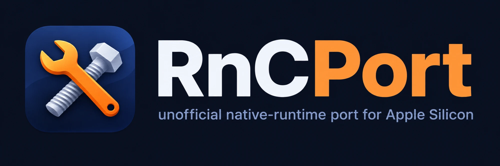

<p align="center"></p>

# RnCPort

An unofficial, experimental native-runtime port of **Ratchet & Clank (2016, PS4)** to **Apple Silicon Macs**. The game's own x86-64 code runs under Rosetta 2 on a high-level runtime that reimplements the PS4 system libraries, with the shadPS4 video core drawing through Vulkan → KosmicKrisp → Metal.

**Author:** Iuliia Gailova. RnCPort continues [SpartanPort](https://github.com/FelipePrado0/SpartanPort) (God of War III), which itself grew out of [bloodborne_pc](https://github.com/Supermedo/bloodborne_pc); see [Credits](#credits).

> **Not affiliated with Sony Interactive Entertainment or Insomniac Games.** Ratchet & Clank is a trademark of its owners. This repository contains no game code, data or artwork: you need a dump of **your own** copy of the game.

## Status (November 2026)

| | |
|---|---|
| Game | Ratchet & Clank, **CUSA01047** (EU), version **01.00** (base game) |
| Tested on | MacBook Pro **M1, 8 GB**, macOS 27.2.1 |
| Boot, logos, Bink intro videos | ✅ |
| Audio (Wwise, ATRAC9) | ✅ |
| PS4 controller | ✅ |
| Main menu, New Game / Continue, save data | ✅ (menu at 30 FPS) |
| First level loads, its cutscene plays | ✅ |
| First level, gameplay after the cutscene | ✅ playable on 8 GB, but slow: about 7–10 FPS in gameplay, 30 FPS in lighter scenes |
| Other regions (CUSA01073, CUSA01928), patch 01.09 | not tested |

On the same Mac the game did not boot at all before: shadPS4 stops at an access to `0x1000000068`. What it took is listed in [What RnCPort changes](#what-rncport-changes).

## Requirements

- Apple Silicon Mac (M1 or newer), **macOS 26 or newer**, Rosetta 2.
- A dump of **your own** copy of the game from your own PS4 (base game; the decrypted `eboot.bin` starts with `7F 45 4C 46`). No game files are included or linked here.
- For building: Xcode Command Line Tools, Homebrew, about 2 GB for the x86-64 dependencies.
- **Memory:** 8 GB works but is tight (see [Known issues](#known-issues)); 16 GB or more is **not tested yet** — reports are very welcome.

## Build and run

```bash
bash packaging/macos/build-deps.sh   # x86-64 Vulkan loader, KosmicKrisp, SDL3, FFmpeg… (once, ~10 min)
bash build.sh --test                 # runtime, GPU library and tests (~3 min)
```

Put the dump folder **`CUSA01047`** next to the `RnCPort` folder and start the game:

```text
Games/
├── CUSA01047/      ← your dump (eboot.bin, sce_sys/, asset_archive/ …)
└── RnCPort/        ← this repository
```

```bash
python3 run.py
```

Settings (`spartanport.ini`), saves, the shader cache and generated files go to `~/Library/Application Support/RnCPort`. Both locations can be changed:

```bash
SPARTAN_GAME_DIR=~/Games/MyDump SPARTAN_DATA_DIR=~/Games/RnCPortData python3 run.py
```

The game profile (patch `Bug Fix - Address Space Base`, precise readbacks) is applied automatically for CUSA01047.

## What RnCPort changes

- **Address space patch** ([`patches/CUSA01047.xml`](patches/CUSA01047.xml)). The game's own virtual address allocator hands out 2 GiB slots from `0x1000000000`, inside the range macOS reserves in every process (`0xfc0000000…0x7000000000`, also under Rosetta 2), and relies on the kernel honouring that address. The base moves to `0x8000000000` (4 instructions), its inverse with it (3) and the slot count from 472 to 248 (4). The other 59 uses of `0x1000000000` in the executable are feature flag masks and stay untouched. shadPS4 already ships the same base move for version 01.09 ("macOS Memory Workaround" by squidbus in [shadps4-emu/ps4_cheats](https://github.com/shadps4-emu/ps4_cheats/blob/main/PATCHES/Ratchet_and_Clank.xml)); this patch is for 01.00 and also adjusts the inverse and the slot count so that the slots stay below the 40-bit GPU address limit.
- **~140 runtime functions** the game needs beyond God of War III: event flags and POSIX semaphores, thread scheduling parameters, time conversions, RFC 3339/2822 date parsing, and offline PSN services, dialogs, sockets and PlayGo.
- **Runtime fixes:** the thread handle starts with a non-zero thread id (the game reads it right after `pthread_create`), timed waits carry a deadline of exactly one second, GPU commands may carry more than 128 KiB of data, the queue of GPU memory notifications grows as needed.
- **Precise readbacks by default** for this game: it busy-waits until the GPU has written results to memory.
- **GPU memory on 8 GB Macs:** large upload buffers are freed after a few seconds idle instead of after 3000 frames (never, at 1 FPS); about 1.9 GB of idle staging took the first level from ~1 FPS to 30 FPS.
- **PRT apertures** are mapped for the GPU, as in shadPS4.
- **Diagnostics:** `SPARTAN_THREAD_TRACE=1`, `SPARTAN_IMPORT_MAP=1` (with `--check-imports`), `SPARTAN_LAUNCH_PREFIX` (start under a debugger).

## Known issues

- **Memory on 8 GB Macs.** GPU memory is about 3.5–4 GB in the first level and macOS swaps; gameplay runs at about 7–10 FPS. The GPU layer still keeps copies of guest memory in Vulkan buffers (~1.2 GB) and a 512 MB address table.
- **Occasional crashes in the level** (inside Metal when the driver opens an encoder, or in `Scheduler::BeginRendering`), after one to a few minutes. Not found yet; a Metal 4 allocator reset was tried and measured, and it is not the cause.
- **Occasional black screen at start** (a race between threads, not yet found).
- Only the EU base game is tested.

## Testing wanted

RnCPort has only been run on an 8 GB M1. If you have an Apple Silicon Mac with **16 GB or more** and your own copy of the game, please open an issue with:

- Mac model, memory, macOS version;
- Title ID and version of your dump (from `sce_sys/param.sfo`), e.g. CUSA01047 01.00;
- how far the game got (menu, first level, gameplay) and the FPS you saw;
- the log (frame statistics are on by default): `python3 run.py > rncport.log 2>&1`.

A report that it works is just as useful as one that it fails.

## Credits

- **SpartanPort** — Felipe Prado and contributors: the God of War III port, its macOS runtime (Fleurat, nizwar, Incognito-Coder) and tooling this project is built on. Its README is kept in [docs/spartanport](docs/spartanport/README.md).
- **bloodborne_pc** — deadinside28, Supermedo and contributors: the original native-runtime loader.
- **shadPS4** — the PS4 emulator project whose video core this port uses and whose implementations of PS4 system functions served as reference.
- **KosmicKrisp** (Mesa) — Vulkan on Metal.
- Logo: original artwork (no game art), generated for this project.

## License

GPL-2.0, as SpartanPort, bloodborne_pc and shadPS4. See [LICENSE](LICENSE).
